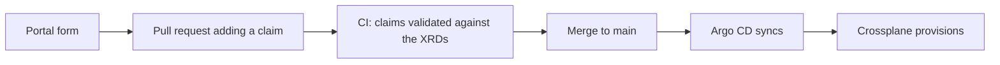

# Your IdPlatformKit instances

**The claims of your IdPlatformKit installation**: every `Tenant`, `PostgresDatabase` and `App` that should exist on your platform, declared in Git.

This repository was created from [idPlatformKit/instances-template](https://github.com/idPlatformKit/instances-template), usually by the Orchestrator's guided install (`make setup`). Argo CD syncs it onto your cluster, and the [Orchestrator](https://github.com/idPlatformKit/Orchestrator)'s compositions turn each claim into real resources.



It starts empty. Claims normally arrive through the portal's **New Tenant** and **New Postgres database** templates, which open pull requests here under your own GitHub identity. `App`s arrive from each app's CI ([app-template-go](https://github.com/idPlatformKit/app-template-go)), through your installation's deployer GitHub App: one pull request per deployment to staging, one per promotion to prod.

## Layout

```
tenants/<tenant>.yaml                   # cluster-scoped: one per team
databases/<namespace>/<name>.yaml       # namespaced: lives in one of the tenant's namespaces, <tenant>-<environment>
apps/<namespace>/<name>.yaml            # namespaced: an app in one environment, written by the app's CI
catalog/                                # one Backstage entity per tenant and database, read by the portal
```

Argo CD syncs `tenants/`, `databases/` and `apps/`. It ignores `catalog/` and `.github/`.

## Requirements

- **Public**, unless you give Argo CD credentials for it: the local install reads it anonymously.
- The `main` branch is what Argo CD syncs.

## Deleting is real

Argo CD syncs this repository with `prune` enabled. **Removing a file deletes the resource**: removing a `Tenant` deletes its namespaces and everything in them, including its OpenBao namespace and secrets.

Databases are the exception, because they hold data:

- Removing a `PostgresDatabase`, or the tenant it lives in, **keeps the database** on the server, unmanaged: adding the same file back adopts it again, data included. To drop it, set `spec.deletionPolicy: Delete` in one pull request, then remove the file in the next.
- An `App` can't be removed until its services are confirmed in its annotation `platform.idplatformkit.io/delete-services` (Argo CD shows the refusal); a service removed from it is kept until confirmed there too. See [Protecting the data](https://github.com/idPlatformKit/Orchestrator/blob/main/docs/compositions/app.md#protecting-the-data).

## Docs

- [Install IdPlatformKit](https://idplatformkit.github.io/start/run-locally/)
- [`Tenant`](https://github.com/idPlatformKit/Orchestrator/blob/main/docs/compositions/tenant.md), [`PostgresDatabase`](https://github.com/idPlatformKit/Orchestrator/blob/main/docs/compositions/postgres-database.md) and [`App`](https://github.com/idPlatformKit/Orchestrator/blob/main/docs/compositions/app.md)

## License

[Apache 2.0](LICENSE)
