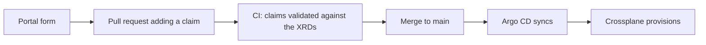

# Your IdPlatformKit instances

**The claims of your IdPlatformKit installation**: every `Tenant` and `PostgresDatabase` that should exist on your platform, declared in Git.

This repository was created from [idPlatformKit/instances-template](https://github.com/idPlatformKit/instances-template), usually by the Orchestrator's guided install (`make setup`). Argo CD syncs it onto your cluster, and the [Orchestrator](https://github.com/idPlatformKit/Orchestrator)'s compositions turn each claim into real resources.



It starts empty. Claims normally arrive through the portal's **New Tenant** and **New Postgres database** templates, which open pull requests here under your own GitHub identity.

## Layout

```
tenants/<tenant>.yaml                   # cluster-scoped: one per team
databases/<namespace>/<name>.yaml       # namespaced: lives in the tenant's namespace
catalog/                                # one Backstage entity per tenant and database, read by the portal
```

Argo CD syncs `tenants/` and `databases/`. It ignores `catalog/` and `.github/`.

## Requirements

- **Public**, unless you give Argo CD credentials for it: the local install reads it anonymously.
- The `main` branch is what Argo CD syncs.

## Deleting is real

Argo CD syncs this repository with `prune` enabled. **Removing a file deletes the resource**: removing a `Tenant` deletes its namespace and everything in it, including its OpenBao namespace and secrets. Removing a `PostgresDatabase` drops the database.

## Docs

- [Install IdPlatformKit](https://idplatformkit.github.io/start/run-locally/)
- [`Tenant`](https://github.com/idPlatformKit/Orchestrator/blob/main/docs/compositions/tenant.md) and [`PostgresDatabase`](https://github.com/idPlatformKit/Orchestrator/blob/main/docs/compositions/postgres-database.md)

## License

[Apache 2.0](LICENSE)
